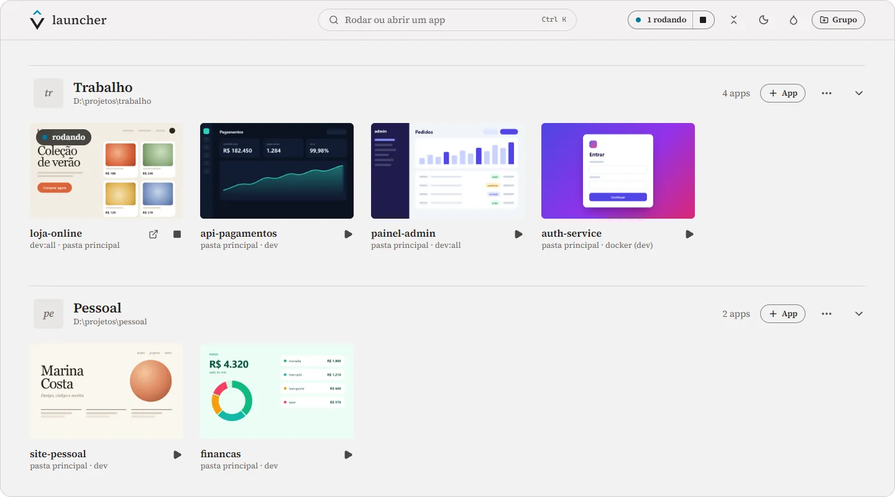
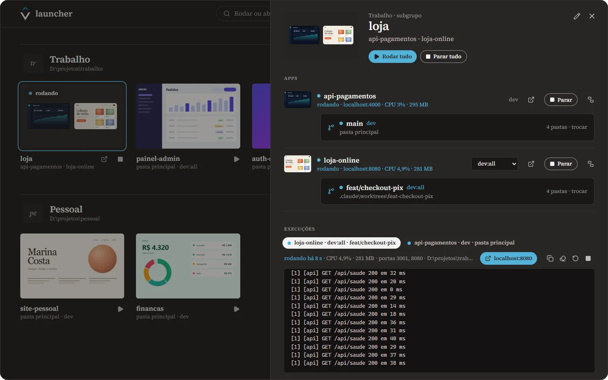
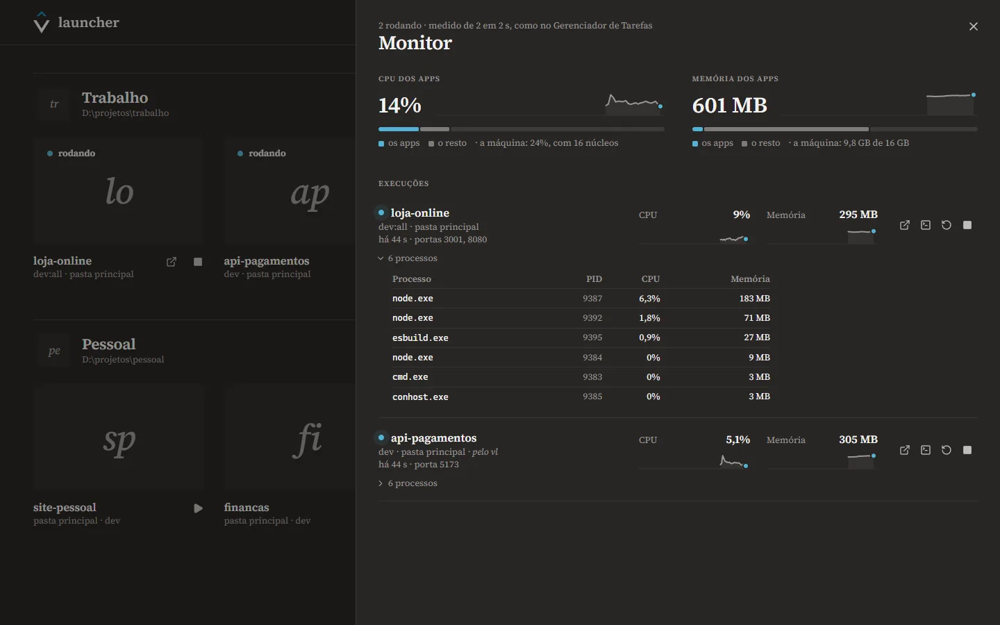

<div align="center">


# vlauncher

**Os projetos em que você trabalha, a um clique.**

Rode cada app na branch certa, acompanhe a saída e veja quanto ele pesa,<br>
sem caçar terminal nem porta presa.

<br>

[](../../releases/latest)


</div>

<br>

<picture>
  <source media="(prefers-color-scheme: dark)" srcset="docs/galeria-escuro.webp">
  
</picture>

<p align="center">
  <a href="#baixar-e-instalar"><b>Baixar</b></a> &nbsp;·&nbsp;
  <a href="#primeiros-passos">Primeiros passos</a> &nbsp;·&nbsp;
  <a href="#o-que-ele-faz">O que ele faz</a> &nbsp;·&nbsp;
  <a href="#no-terminal-e-no-claude-code">Terminal e Claude Code</a> &nbsp;·&nbsp;
  <a href="#perguntas-frequentes">Perguntas</a> &nbsp;·&nbsp;
  <a href="#desenvolver">Desenvolver</a>
</p>

<details>
<summary><b>In English</b></summary>
<br>

vlauncher is a Windows desktop app to organize and run the projects you work on. Group your apps,
define how each one runs (`npm run dev:all`, `docker compose up`...), pick the branch or git worktree
before running, bundle a front end and its API from separate repositories into a subgroup that runs
together, follow the output in place and watch each app's CPU, memory and ports. The bundled
`vl` command line drives it from any terminal, so a dev server started by Claude Code (through the
included skill) shows up in the launcher too. Built with Tauri 2, Rust and React; the interface is in
Brazilian Portuguese. [Download the latest installer](../../releases/latest).

</details>

## Por quê

Quem mantém vários projetos repete o mesmo ritual o dia inteiro: abrir um terminal, entrar na pasta
certa, lembrar qual script sobe o app inteiro, achar a worktree da branch que está revisando,
descobrir que ela está sem `node_modules` e sem `.env`, e depois caçar qual janela está segurando a
porta 8080. O vlauncher põe tudo isso numa tela só.

## Baixar e instalar

1. **Baixe** o `vlauncher_x.y.z_x64-setup.exe` na [página da versão mais recente](../../releases/latest).
2. **Abra o instalador.** Ele instala só para você, sem pedir administrador, em `%LOCALAPPDATA%\vlauncher`.
3. **Abra o vlauncher** pelo menu Iniciar, ou com `Ctrl+Alt+Espaço` de qualquer lugar.

> [!IMPORTANT]
> O instalador ainda não tem assinatura de código, por isso o Windows pode mostrar **"O Windows
> protegeu o computador"**. Clique em **Mais informações** e depois em **Executar assim mesmo**.

- **Sistema:** Windows 10 ou 11, de 64 bits. O WebView2 já vem no Windows 11; no 10, o instalador o
  baixa se faltar.
- **Bom ter no PATH:** o `git` (para as branches e as worktrees), o [Windows Terminal](https://aka.ms/terminal),
  o VS Code, o PowerShell 7 e o [Claude Code](https://docs.anthropic.com/claude-code). Nenhum é obrigatório.
- **Atualizar:** baixe e rode o instalador novo. Os grupos, os apps e as fotos ficam.
- **Desinstalar:** Configurações → Apps → vlauncher.

> [!TIP]
> Tinha a 0.1.0, que se instalava como "Launcher"? Saia dela pela bandeja ("Encerrar os apps e sair")
> e rode o instalador novo: ele tira o "Launcher" e mantém os seus dados.

## Primeiros passos

1. **Crie um grupo pela pasta dos projetos.** Em "Criar grupo de uma pasta", aponte para onde eles
   ficam (como `D:\projetos\trabalho`) e marque os que quiser. Cada um entra com as variações que o
   `package.json` sugere (`dev:all`, `dev`, `start`), ou com o `docker compose`, num projeto só com Docker.
2. **Rode.** O triângulo da prancha roda a variação padrão. O painel do app mostra a saída e o endereço
   que ele anunciou, a um clique.
3. **Escolha onde rodar.** Em "Onde rodar": a pasta principal, uma worktree ou uma branch, que vira
   worktree num clique.
4. **Ponha fotos.** Arraste uma imagem do Explorer para a prancha do app, ou cole um print (`Ctrl+V`)
   no campo de foto.

## O que ele faz

### Roda cada app do jeito certo

Cada app tem as suas **variações**: o comando, as variáveis de ambiente, um endereço fixo (se quiser) e
abrir o navegador quando ele estiver pronto. A saída aparece ao vivo, com os erros em destaque, e parar
encerra a árvore inteira de processos (o `npm`, o `node`, o `vite`): a porta fica livre de verdade.


### Branches e worktrees, sem ritual

Escolha a pasta antes de rodar: a principal ou qualquer worktree. Uma branch sem worktree ganha uma num
clique, já com os arquivos que o git não leva (`.env*`, `.npmrc`). O vlauncher avisa quando falta o
`node_modules` e instala com o gerenciador do projeto (npm, pnpm, yarn ou bun). Num monorepo, o app roda
na mesma subpasta de cada worktree. As pastas em que o app está rodando ganham o ponto ciano.


### O sistema inteiro, num clique

O front e a API costumam morar em repositórios separados. Junte os dois num **subgrupo**: na galeria,
eles viram um cartão só, como uma pasta do iPhone, e o painel dele mostra cada app com a sua worktree e
a saída de todos. **Rodar tudo** sobe cada um com a variação escolhida, a API antes do front, cada um na
sua pasta: a loja na worktree da feature, a API na principal. Crie em "Novo subgrupo", no menu do grupo;
o vlauncher sugere os repositórios que moram na mesma pasta.



### Quanto cada app pesa

O monitor mostra a CPU e a memória de cada app, somando a árvore de processos inteira, de 2 em 2
segundos e com os últimos 3 minutos num minigráfico. Mostra também as portas em que ele escuta e os
processos, um a um, ao lado do que a máquina inteira está usando. Mede como o Gerenciador de Tarefas e
abre pelo "N rodando" do topo.



### Do terminal e do Claude Code

O `vl`, que vem junto, roda, para e lê a saída dos apps pela linha de comando, e o que sobe por ele
aparece no vlauncher como qualquer outro. Com a skill que o acompanha, o Claude Code passa a subir os
servidores por ele. Veja [No terminal e no Claude Code](#no-terminal-e-no-claude-code).

```sh
vl rodar loja-online   # roda a variação padrão e espera o endereço
vl rodar loja          # o subgrupo: a API e o front, cada um na sua worktree
vl status              # o que está rodando, com a CPU e a memória
```

### De qualquer lugar

`Ctrl+Alt+Espaço` traz o vlauncher com a busca aberta: digite parte do nome e aperte Enter para rodar,
abrir o endereço, parar ou abrir o painel. Com algo rodando, fechar a janela só a esconde na bandeja, e
os servidores seguem no ar.


### Tinta, papel e vidro

Tema escuro ou claro e, por cima de qualquer um, o liquid glass: a janela fica transparente, de 0 a
100%, com o acrylic do Windows desfocando o que está atrás.


## No terminal e no Claude Code

O `vl` fica ao lado do vlauncher, em `%LOCALAPPDATA%\vlauncher` (ponha essa pasta no PATH para chamá-lo
de qualquer terminal). Ele fala com o vlauncher aberto e, se estiver fechado, o abre só na bandeja. Só
roda o que já está no launcher: o app e a variação vêm pelo nome, nunca um comando.

| Comando | O que faz |
| --- | --- |
| `vl status` | O que está rodando: endereço, CPU, memória e portas |
| `vl apps` | Os apps, com as variações e onde cada um roda, e os subgrupos |
| `vl rodar [app]` | Roda a variação padrão e espera o app anunciar o endereço (até 60 s) |
| `vl parar [app]` | Para o app; `vl parar --todas` para tudo o que está rodando |
| `vl reiniciar [app]` | Para e roda de novo |
| `vl saida [app]` | As últimas linhas da saída (`-n 200` para mais) |
| `vl abrir [app]` | Traz o vlauncher, com o painel do app aberto |

Sem o nome, vale o app da pasta atual, na worktree em que ela está: dentro de
`.claude\worktrees\feat-x`, o `vl rodar` roda o app nessa worktree, e o vlauncher passa a mostrá-la em
"Onde rodar". O nome pode ser só um pedaço, sem acento: `vl rodar pagamentos` acha o api-pagamentos.
Outras opções: `-v <variação>`, `--local <branch>`, `--sem-esperar` e `--json`.

O nome de um subgrupo vale para todos os apps dele: `vl rodar loja` sobe cada um com a variação
escolhida no subgrupo e espera os endereços, e `parar`, `reiniciar` e `saida` valem para todos. Com
`--local`, roda na worktree da branch cada app que a tiver (a mesma feature no front e na API). Se um app
e um subgrupo tiverem o mesmo nome, diga qual: `vl rodar "subgrupo loja"`.

### Com o Claude Code

Um servidor que o Claude Code sobe por conta própria (`npm run dev` num shell dele) não aparece no
vlauncher. A skill `vlauncher` ensina o Claude a usar o `vl`:

```sh
vl instalar-skill                         # em ~/.claude (ou na CLAUDE_CONFIG_DIR)
vl instalar-skill --em ~/.claude-pessoal  # noutra conta
```

Depois, numa sessão, "sobe a loja" vira `vl rodar loja`: a loja aparece rodando no vlauncher, com a
saída e o monitor, e o Claude lê os erros pelo `vl saida`. A skill está em
[`claude-code/vlauncher/SKILL.md`](claude-code/vlauncher/SKILL.md).

## Atalhos

| Atalho | O que faz |
| --- | --- |
| `Ctrl+Alt+Espaço` | De qualquer lugar do Windows: mostra o vlauncher com a busca aberta (ou o esconde) |
| `Ctrl+K` | Abre a busca |
| `Esc` | Fecha a busca, o diálogo, o painel ou o monitor |
| `Ctrl+Alt+=` / `Ctrl+Alt+-` | Com o liquid glass: menos ou mais transparente, de 5 em 5 |
| `Ctrl+Alt+0` | Com o liquid glass: opaco |

## Perguntas frequentes

<details>
<summary><b>É de graça?</b></summary>
<br>

Sim. O código é aberto, com a [licença MIT](LICENSE).

</details>

<details>
<summary><b>Funciona no Mac ou no Linux?</b></summary>
<br>

Não. Ele usa o `cmd`, o `taskkill`, o Windows Terminal, o WebView2 e o acrylic do Windows.

</details>

<details>
<summary><b>Meus dados vão para algum lugar?</b></summary>
<br>

Não. Sem conta, sem servidor, sem telemetria. Tudo fica em `%APPDATA%\br.com.viniciusventura.launcher\`:
o `launcher.json` (grupos, apps, variações e preferências, com a versão anterior no `launcher.json.bak`)
e a pasta `imagens\`, com as fotos. Veja também [Privacidade e segurança](#privacidade-e-segurança).

</details>

<details>
<summary><b>Por que o Windows avisa na instalação?</b></summary>
<br>

O instalador não tem assinatura de código, que é cara para um projeto pessoal. Em "O Windows protegeu o
computador", clique em **Mais informações → Executar assim mesmo**. O código está todo aqui, para quem
quiser conferir ou [gerar o próprio instalador](#desenvolver).

</details>

<details>
<summary><b>Preciso do git, do Windows Terminal ou do Claude Code?</b></summary>
<br>

Nenhum é obrigatório. Sem o git, cada app roda na pasta dele, sem a escolha de branch e de worktree.
Sem o Windows Terminal, os atalhos do painel abrem o `cmd`. O Claude Code só entra no botão do painel e
na skill.

</details>

<details>
<summary><b>Subi um servidor noutro terminal. Por que ele não aparece?</b></summary>
<br>

O vlauncher (e o monitor, e o `vl`) só enxerga o que ele mesmo rodou. Rode pelo vlauncher ou, no
terminal, com `vl rodar`.

</details>

<details>
<summary><b>Como rodo duas worktrees do mesmo app ao mesmo tempo?</b></summary>
<br>

Escolha a outra worktree em "Onde rodar" e rode de novo: as duas ficam no ar, cada uma com a sua aba e a
sua linha no monitor, e as pastas que estão rodando ganham o ponto ciano. Só que as duas disputam as
portas. O Vite pula sozinho para a próxima porta livre, mas uma API costuma não pular. Crie uma variação
com outra porta nas variáveis de ambiente, como `PORT=3002` (e, se o front encaminha para a API, o
endereço dela, como `VITE_API_PROXY_TARGET=http://localhost:3002`).

</details>

<details>
<summary><b>Uso mais de uma conta do Claude Code. Dá para escolher?</b></summary>
<br>

Dá. No menu do botão Claude Code, em "Configurar contas…", dê a cada conta um nome e um comando. O
comando pode ser uma função do seu perfil do PowerShell que escolhe a conta, por exemplo:

```powershell
# no seu $PROFILE
function claude-trabalho { $env:CLAUDE_CONFIG_DIR = "$HOME\.claude-trabalho"; claude.exe @args }
```

Com duas ou mais contas, o botão pergunta qual abrir.

</details>

## Privacidade e segurança

- **Nada sai do seu computador.** A única rede é o `git fetch`, quando você clica em "Buscar no remoto",
  e o navegador, quando você abre um endereço.
- **Os comandos rodam com o seu usuário**, como se você os digitasse no terminal. Só adicione projetos e
  comandos em que você confia.
- **Não guarde segredos nas variações.** As variáveis de ambiente ficam em texto puro no
  `launcher.json`; os segredos continuam no `.env` do projeto.
- **Os arquivos locais só andam dentro do repositório**: o vlauncher copia `.env*` e `.npmrc` da pasta
  principal para uma worktree do mesmo repositório, sem sobrescrever nada, e para nenhum outro lugar.
- **O `vl` conversa só dentro da máquina**, por um named pipe (`\\.\pipe\vlauncher-<usuário>`) que
  recusa conexões de fora. Pela permissão padrão do Windows, só o seu usuário (e os administradores)
  escreve nele, e o pedido traz o nome de um app e de uma variação, nunca um comando.
- **O monitor só lê** os processos de cada execução, a CPU e a memória deles e as portas em escuta, como
  o Gerenciador de Tarefas. Nada disso é gravado.
- **A interface é fechada**: só conversa com o núcleo pelo IPC do Tauri, a política de conteúdo (CSP) só
  aceita o que vem do próprio app, e as fotos só saem da pasta de imagens dele.
- **Liquid glass:** para o acrylic não virar uma cor sólida quando a janela perde o foco, o vlauncher diz
  ao Windows que a moldura continua ativa (a mensagem `WM_NCACTIVATE`). Com o desfoque ligado, a barra de
  título não acinzenta sem foco; o foco do teclado não muda.

## Desenvolver

Precisa do Windows, do [Node](https://nodejs.org) 22+ com o [pnpm](https://pnpm.io) e do
[Rust](https://rustup.rs) com o toolchain MSVC (o do Visual Studio Build Tools).

```sh
pnpm install
pnpm app          # o vlauncher em desenvolvimento (Tauri + Vite, com recarga)
pnpm dev          # só a interface no navegador, com dados de exemplo (bom para mexer no visual)
pnpm app:build    # o instalador, em src-tauri\target\release\bundle\nsis\
```

```sh
pnpm test && pnpm typecheck && pnpm lint
cd src-tauri && cargo test
```

<details>
<summary><b>Testar sem tocar nos seus dados</b></summary>
<br>

`LAUNCHER_DADOS` aponta os dados para outra pasta (a config, as fotos, o perfil do WebView2 e o pipe do
`vl`), assim o teste roda ao lado do vlauncher instalado sem tocar nele. Com o DevTools remoto do
WebView2, dá para inspecionar o app de verdade em `http://127.0.0.1:9223` (pelo `edge://inspect` ou com o
puppeteer); no desenvolvimento, os stores ficam em `window.launcher`.

```sh
LAUNCHER_DADOS=C:/caminho/dados-teste WEBVIEW2_ADDITIONAL_BROWSER_ARGUMENTS=--remote-debugging-port=9223 pnpm app
```

O `vl` de desenvolvimento sai do `cargo build --bin vl`, em `src-tauri\target\debug`. Com a mesma
`LAUNCHER_DADOS` no terminal, ele fala com o vlauncher do teste, nunca com o instalado.

</details>

<details>
<summary><b>Publicar uma versão</b></summary>
<br>

Suba a versão em `package.json`, `src-tauri/Cargo.toml` e `src-tauri/tauri.conf.json`, gere o instalador
com `pnpm app:build` e anexe-o a uma Release do GitHub:

```sh
gh release create v0.3.0 src-tauri/target/release/bundle/nsis/vlauncher_0.3.0_x64-setup.exe --title "vlauncher 0.3.0"
```

O botão "Baixar para Windows" aponta para a Release mais recente.

</details>

<details>
<summary><b>Por dentro</b></summary>
<br>

- **[Tauri 2](https://tauri.app)**: o núcleo em Rust inicia e encerra processos (com a árvore inteira),
  mede a CPU e a memória deles, roda o git, lê as pastas, atende o `vl`, fica na bandeja e registra o
  atalho global. O Tauri usa o WebView2 que já vem no Windows, então o instalador tem 2 MB.
- **React 19, Vite e Tailwind 4** na interface, com [dnd-kit](https://dndkit.com) para arrastar e
  [zustand](https://zustand.docs.pmnd.rs) para o estado. Os dados são um JSON, sem banco.

```
src-tauri/src/
  processos.rs   execuções: iniciar, a saída em lotes, a URL anunciada, parar a árvore (taskkill /T)
  monitor.rs     a CPU, a memória, os processos e as portas de cada execução, de 2 em 2 s
  canal.rs       o named pipe por onde o vl fala com o launcher
  bin/vl.rs      o vl, a linha de comando (protocolo.rs: o nome do pipe, dividido com ele)
  git.rs         worktrees, branches, criar worktree, trocar branch, copiar .env e .npmrc
  projetos.rs    reconhece o projeto numa pasta e os scripts que sobem o app
  dados.rs       launcher.json e as imagens
  sistema.rs     VS Code, Windows Terminal, Claude Code, Explorer, navegador
  janela.rs      bandeja e atalho global
  vidro.rs       o acrylic do liquid glass com a janela sem foco
src-tauri/instalador/  o gancho do instalador que tira o "Launcher" da 0.1.0
src/
  lib/           tipos, a ponte com o Rust (api.ts), os stores, os subgrupos (subgrupos.ts), o que o vl
                 pede (canal.ts, apps.ts)
  components/    galeria, capítulo, prancha, subgrupo, painel, monitor, onde rodar, console, diálogos, busca
claude-code/     a skill vlauncher, que o vl instalar-skill grava
```

</details>

## Licença

O código é [MIT](LICENSE). O símbolo (o V com o chapéu) e a identidade visual são da marca
[Vinícius Ventura](https://viniciusventura.com.br) e não entram na licença: num fork, troque o ícone
(`src-tauri/icons`, gerado por `scripts/gerar-icone.py`) e o símbolo (`src/components/Marca.tsx`).

A fonte é a [Source Serif 4](https://github.com/adobe-fonts/source-serif) (SIL Open Font License) e os
ícones são do [Lucide](https://lucide.dev) (ISC). As fotos dos apps nas capturas são de projetos
fictícios.

<br>

<p align="center">
  <sub>Feito por <a href="https://viniciusventura.com.br">Vinícius Ventura</a></sub>
</p>
