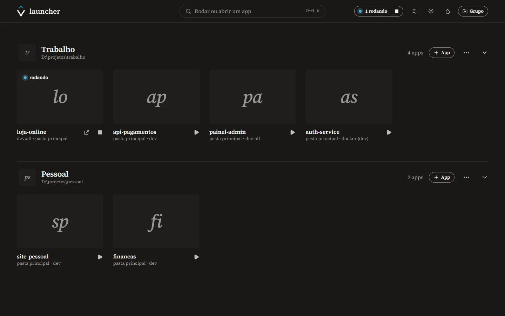
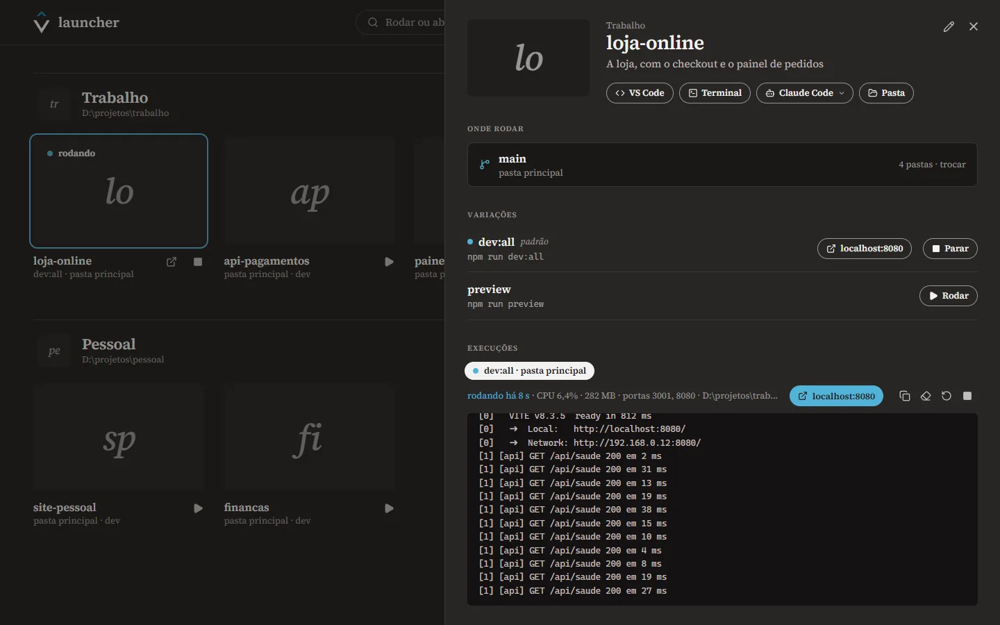
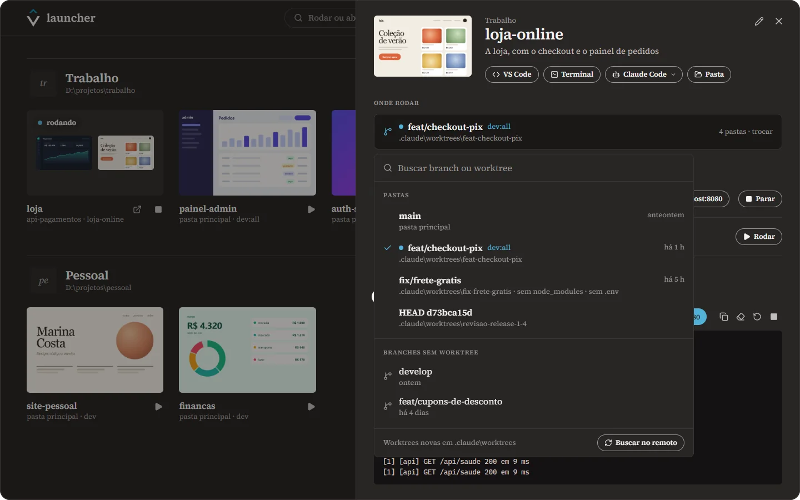
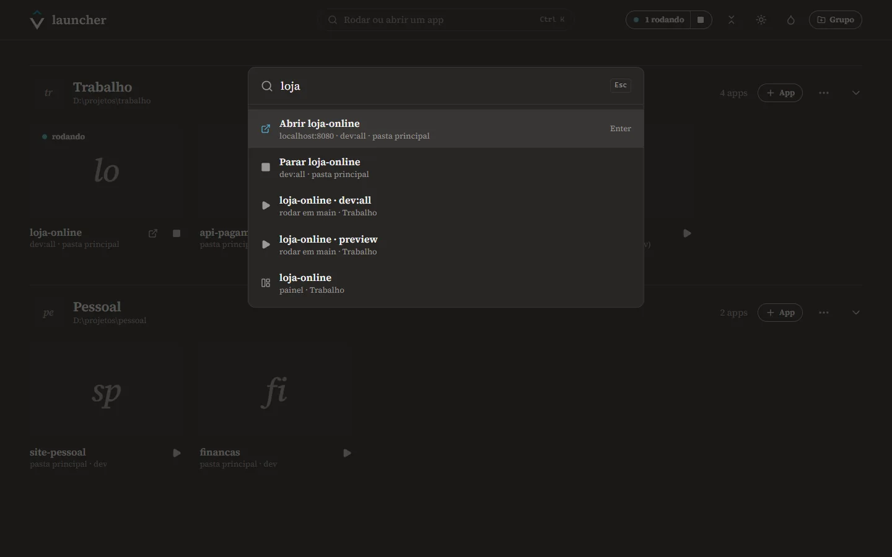
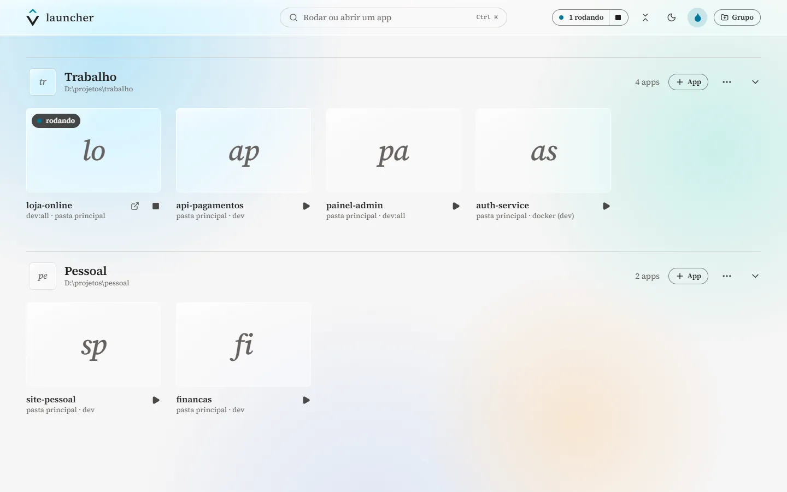

<p align="center">
  
</p>

<h1 align="center">vlauncher</h1>

<p align="center">
  Um launcher para os projetos em que você trabalha. Rode qualquer app com um clique, na branch ou na
  worktree que você escolher, e acompanhe a saída sem abrir um terminal.
</p>

<p align="center">
  <a href="#instalar">Instalar</a> ·
  <a href="#como-usar">Como usar</a> ·
  <a href="#atalhos">Atalhos</a> ·
  <a href="#privacidade-e-segurança">Privacidade</a> ·
  <a href="#desenvolver">Desenvolver</a>
</p>

<p align="center">
  
</p>

> **English:** vlauncher is a Windows desktop app to organize and run your local projects. Group your
> apps, define how each one runs (`npm run dev:all`, `docker compose up`...), pick the branch or git
> worktree before running, and follow the output in place. Built with Tauri 2, React and Rust. The
> interface is in Brazilian Portuguese.

## Por quê

Quem mantém vários projetos repete o mesmo ritual o dia inteiro: abrir um terminal, entrar na pasta
certa, lembrar qual script sobe o app inteiro, achar a worktree da branch que está revisando,
descobrir que a worktree nova está sem `node_modules` e sem `.env`, e depois caçar qual janela de
terminal está segurando a porta 8080. O vlauncher põe isso numa tela só.

## O que ele faz

**Organiza.** Os apps ficam em grupos, cada um com foto (ou uma capa com as iniciais). Um grupo pode
apontar para a pasta onde ficam os projetos: o vlauncher acha os que ainda não estão lá e já sugere
como rodar cada um. Arraste para reordenar ou para mudar de grupo; recolha um grupo ou todos.

**Roda.** Cada app tem as suas variações, que são os jeitos de rodá-lo: um comando, um endereço fixo
(opcional), variáveis de ambiente, abrir o navegador quando estiver pronto ou rodar no Windows Terminal.
Ao adicionar um app, ele lê o `package.json` e sugere os scripts que sobem o app inteiro (`dev:all`,
`dev`, `start`), nunca migrações nem builds. A saída aparece ao vivo, com o endereço que o app anunciou
a um clique. Parar encerra a árvore inteira de processos (o `npm`, o `node`, o `vite`), e a porta fica
livre de verdade.

<p align="center">
  
</p>

**Entende branches e worktrees.** Antes de rodar, escolha a pasta: a principal ou qualquer worktree. As
branches que ainda não têm worktree ganham uma num clique, já com os arquivos locais que o git não leva
(`.env*`, `.npmrc`). Ele avisa quando falta `node_modules` e instala com o gerenciador do projeto (npm,
pnpm, yarn ou bun). Num monorepo, o app roda na mesma subpasta de cada worktree.

<p align="center">
  
</p>

**Abre o resto.** Do painel de cada app: VS Code, Windows Terminal, Claude Code (com mais de uma conta,
se você usar) e a pasta no Explorer, todos na pasta escolhida.

**Busca de qualquer lugar.** `Ctrl+Alt+Espaço` traz o vlauncher com a busca aberta. Digite parte do
nome e aperte Enter para rodar uma variação, abrir o endereço, parar o que está rodando ou abrir o painel.

<p align="center">
  
</p>

**Fica na bandeja.** Com algo rodando, fechar a janela só a esconde: os servidores seguem no ar. "Parar
todas" pede confirmação e lista o que vai parar; sair do vlauncher encerra tudo.

**Tinta, papel e liquid glass.** Tema escuro ou claro e, por cima de qualquer um dos dois, o liquid
glass: a janela fica transparente (de 0 a 100%), com o acrylic do Windows desfocando o que está atrás.

<p align="center">
  
</p>

## Instalar

O vlauncher roda no **Windows 10 e 11** (testado no 11) e usa o WebView2, que já vem no Windows 11.

1. Baixe o instalador (`Launcher_x.y.z_x64-setup.exe`) na página de Releases do repositório, ou gere o
   seu (veja [Desenvolver](#desenvolver)).
2. O instalador não é assinado, então o Windows pode mostrar "O Windows protegeu o computador". Clique
   em **Mais informações → Executar assim mesmo**.

Para os atalhos do painel, deixe no PATH o que quiser usar: o [Windows Terminal](https://aka.ms/terminal)
(`wt`), o VS Code (`code`), o PowerShell 7 (`pwsh`) e o [Claude Code](https://docs.anthropic.com/claude-code)
(`claude`). Nada disso é obrigatório.

## Como usar

1. **Crie um grupo.** Com os projetos numa pasta só (como `D:\projetos\trabalho`), use "Criar grupo de
   uma pasta" e marque os projetos que quer. Cada um entra com as variações sugeridas pelo `package.json`
   (ou pelo `docker-compose.dev.yml`, num projeto só com Docker).
2. **Ajuste as variações.** Em ✎ Editar no painel do app: o comando, o endereço fixo, as variáveis de
   ambiente, "abrir no navegador quando estiver pronto" e a estrela que marca a variação padrão (a que o
   ▶ da galeria roda).
3. **Escolha onde rodar.** Em "Onde rodar", a pasta principal, uma worktree ou uma branch, que vira
   worktree em `.claude\worktrees\<branch>` (o lugar muda na edição do app). "Na principal" troca a
   branch da pasta principal, só com a árvore limpa e nada rodando nela.
4. **Ponha fotos.** Arraste uma imagem do Explorer para a prancha do app ou para a foto do grupo, ou cole
   um print (Ctrl+V) no campo de foto do diálogo. Para logos com fundo transparente, use "Inteira no
   branco".

### Atalhos

| Atalho | O que faz |
| --- | --- |
| `Ctrl+Alt+Espaço` | De qualquer lugar do Windows: mostra o vlauncher com a busca aberta (ou o esconde) |
| `Ctrl+K` | Abre a busca |
| `Esc` | Fecha a busca, o diálogo ou o painel |
| `Ctrl+Alt+=` / `Ctrl+Alt+-` | Com o liquid glass ligado: menos ou mais transparente, de 5 em 5 |
| `Ctrl+Alt+0` | Com o liquid glass ligado: opaco |

### Contas do Claude Code

O botão Claude Code abre o Claude Code no PowerShell, na pasta do app. Por padrão roda `claude`. Para ter
mais de uma conta, abra o menu do botão, entre em "Configurar contas…" e dê a cada conta um nome e um
comando. O comando pode ser uma função do seu perfil do PowerShell que escolhe a conta, por exemplo:

```powershell
# no seu $PROFILE
function claude-trabalho { $env:CLAUDE_CONFIG_DIR = "$HOME\.claude-trabalho"; claude.exe @args }
```

Com duas ou mais contas, o botão pergunta qual abrir.

### Dois exemplares do mesmo app

Duas worktrees do mesmo app ao mesmo tempo disputam as portas. O Vite pula sozinho para a próxima porta
livre, mas uma API costuma não pular. Crie uma variação com outra porta nas variáveis de ambiente, por
exemplo `PORT=3002` (e, se o front encaminha para a API, o endereço dela, como
`VITE_API_PROXY_TARGET=http://localhost:3002`).

## Onde ficam os dados

Tudo fica no seu computador, em `%APPDATA%\br.com.viniciusventura.launcher\`:

- `launcher.json`: grupos, apps, variações e preferências (o formato está em
  [`src/lib/tipos.ts`](src/lib/tipos.ts)). A versão anterior fica no `launcher.json.bak`.
- `imagens\`: as fotos, copiadas para cá quando você as escolhe.

## Privacidade e segurança

- **Nada sai do seu computador.** Sem conta, sem servidor, sem telemetria. A única rede é o `git fetch`
  quando você clica em "Buscar no remoto" e o navegador quando você abre um endereço.
- **Os comandos rodam com o seu usuário**, como se você os digitasse no terminal. Só adicione projetos e
  comandos em que você confia.
- **Não guarde segredos nas variações.** As variáveis de ambiente ficam em texto puro no `launcher.json`.
  Segredos continuam no `.env` do projeto.
- **Os arquivos locais só andam dentro do repositório**: o vlauncher copia `.env*` e `.npmrc` da pasta
  principal para uma worktree do mesmo repositório, sem sobrescrever, e para nenhum outro lugar.
- **A interface é fechada**: ela só conversa com o núcleo pelo IPC do Tauri, a política de conteúdo (CSP)
  só aceita o que vem do próprio app, e as fotos só são servidas da pasta de imagens dele.
- **Liquid glass:** para o acrylic não virar uma cor sólida quando a janela perde o foco, o vlauncher diz
  ao Windows que a moldura continua ativa (a mensagem `WM_NCACTIVATE`). Por isso, com o desfoque ligado,
  a barra de título não acinzenta sem foco. Não muda nada no foco do teclado.

## Desenvolver

Precisa do Windows, do [Node](https://nodejs.org) 22+ com o [pnpm](https://pnpm.io) e do
[Rust](https://rustup.rs) com o toolchain MSVC (o do Visual Studio Build Tools).

```sh
pnpm install
pnpm app          # o vlauncher em desenvolvimento (Tauri + Vite, com recarga)
pnpm dev          # só a interface no navegador, com dados de exemplo (bom para mexer no visual)
pnpm app:build    # o instalador em src-tauri\target\release\bundle\nsis\
```

Testes:

```sh
pnpm test && pnpm typecheck && pnpm lint
cd src-tauri && cargo test
```

Para inspecionar o app de verdade (o núcleo em Rust, não os dados de exemplo), rode com o DevTools
remoto do WebView2 e conecte em `http://127.0.0.1:9223` (pelo `edge://inspect` ou com o puppeteer).
`LAUNCHER_DADOS` aponta os dados para outra pasta (a config, as fotos e o perfil do WebView2), assim o
teste não toca nos seus dados e roda ao lado do vlauncher instalado. No desenvolvimento, os stores ficam
em `window.launcher`.

```sh
LAUNCHER_DADOS=C:/caminho/dados-teste WEBVIEW2_ADDITIONAL_BROWSER_ARGUMENTS=--remote-debugging-port=9223 pnpm app
```

### Por dentro

- **[Tauri 2](https://tauri.app)**: o núcleo em Rust inicia e encerra processos (com a árvore inteira),
  roda o git, lê as pastas, fica na bandeja e registra o atalho global. O Tauri usa o WebView2 que já vem
  no Windows, então o instalador tem 2 MB.
- **React 19, Vite e Tailwind 4** na interface, com [dnd-kit](https://dndkit.com) para arrastar e
  [zustand](https://zustand.docs.pmnd.rs) para o estado. Os dados são um JSON, sem banco.

```
src-tauri/src/
  processos.rs   execuções: iniciar, a saída em lotes, a URL anunciada, parar a árvore (taskkill /T)
  git.rs         worktrees, branches, criar worktree, trocar branch, copiar .env e .npmrc
  projetos.rs    reconhece o projeto numa pasta e os scripts que sobem o app
  dados.rs       launcher.json e as imagens
  sistema.rs     VS Code, Windows Terminal, Claude Code, Explorer, navegador
  janela.rs      bandeja e atalho global
  vidro.rs       o acrylic do liquid glass com a janela sem foco
src/
  lib/           tipos, a ponte com o Rust (api.ts), os dados de exemplo e os stores
  components/    galeria, capítulo, prancha, painel, onde rodar, console, diálogos, busca
```

## Limitações

- **Só Windows.** Usa o `cmd`, o `taskkill`, o Windows Terminal, o WebView2 e o acrylic do Windows.
- **Interface em português.**
- **Instalador sem assinatura de código**, por isso o aviso do SmartScreen na primeira vez.

## Licença

O código é [MIT](LICENSE). O símbolo (o V com o chapéu) e a identidade visual são da marca
[Vinícius Ventura](https://viniciusventura.com.br) e não entram na licença: num fork, troque o ícone
(`src-tauri/icons`, gerado por `scripts/gerar-icone.py`) e o símbolo (`src/components/Marca.tsx`).

A fonte é a [Source Serif 4](https://github.com/adobe-fonts/source-serif) (SIL Open Font License) e os
ícones são do [Lucide](https://lucide.dev) (ISC).
